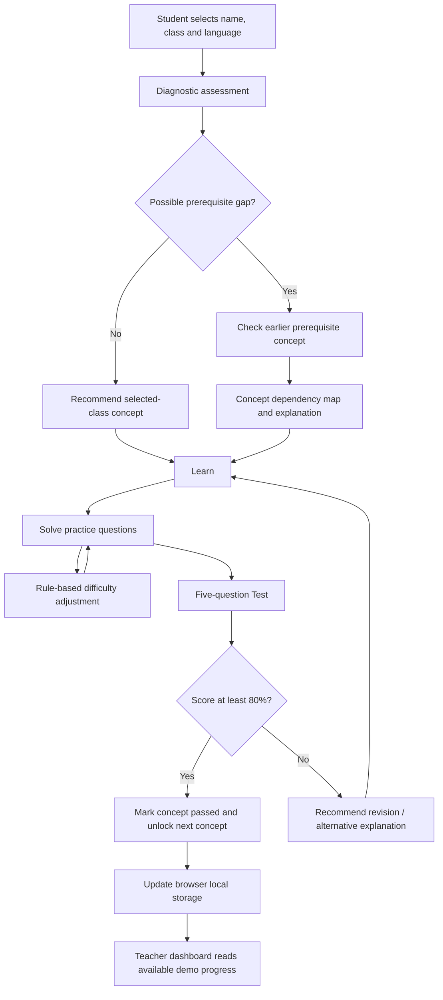

# Setu – Architecture and Flow

The current MVP is a standalone browser application. Its decision logic runs in JavaScript and its demo progress is stored in browser local storage.

## Components
- **Student interface:** collects the student's selected class and presents the learning flow.
- **Diagnostic logic:** checks the current topic and, when indicated, earlier prerequisite concepts.
- **Concept dependency map:** displays the relationship between Integers, Transposing Equations and Linear Equations.
- **Adaptive practice logic:** changes question difficulty using consecutive correct/incorrect answers.
- **Assessment logic:** calculates the five-question test score and applies the 80% pass threshold.
- **Teacher view:** displays the current browser's live student status alongside clearly labelled fictional demonstration records.
- **Persistence:** browser `localStorage`; there is no cloud database or multi-user sync in this version.
